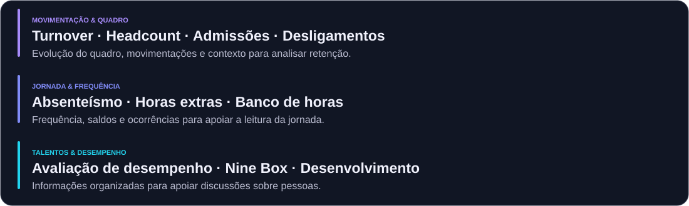
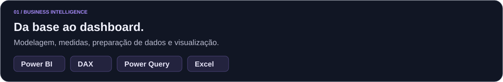

<!-- Portfólio de Gustavo Shoity Horiquiri / versão editorial -->

### Do dado de RH à decisão de negócio.

Sou **Gustavo Shoity Horiquiri — Shoity**, Analista de Recursos Humanos BI. Trabalho na conexão entre **pessoas, dados e tecnologia**, com dashboards, consultas e automações para apoiar a gestão.

[O que eu construo](#o-que-eu-construo) · [Conhecimento em RH](#conhecimento-em-rh) · [Ferramentas](#ferramentas) · [Construindo agora](#construindo-agora)

---

## O que eu construo

<strong>＋ Como essas frentes aparecem no meu trabalho</strong>

- **People Analytics:** acompanhamento de turnover, efetivo, absenteísmo, horas extras e banco de horas; painéis de desempenho e talentos.
- **Automação:** identificação de inconsistências, acompanhamento de atualizações e envio automatizado de informações de RH.
- **Dados:** consultas em SQL Server, transformação de bases, modelagem e validação de históricos.

## Conhecimento em RH

<strong>＋ Aprofundar: ponto, desligamentos e processos admissionais</strong>

- **Consistências de ponto:** interjornada, DSR, marcações ausentes e ajustes.
- **Desligamentos:** pesquisa de desligamento e análise dos registros.
- **Processos admissionais:** admissões recebidas e devolvidas, motivos de devolução e cadastros por filial.

## Ferramentas

## Construindo agora

[Explorar meus projetos e estudos →](https://github.com/GustavoHoriquiri?tab=repositories)

## Dados em movimento

<!-- As frentes descrevem experiência profissional, sem divulgar dados internos.
Adicionar links de projetos específicos e imagens autorizadas quando disponíveis. -->
